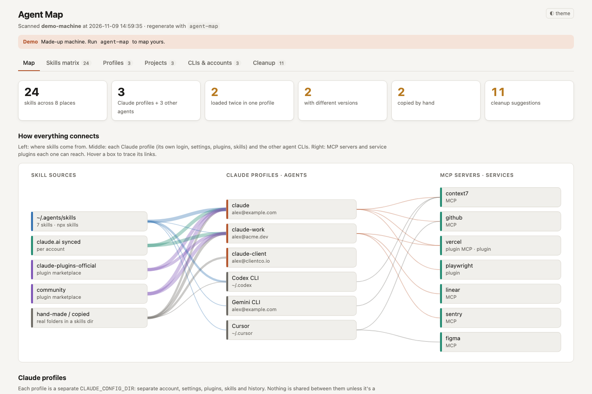
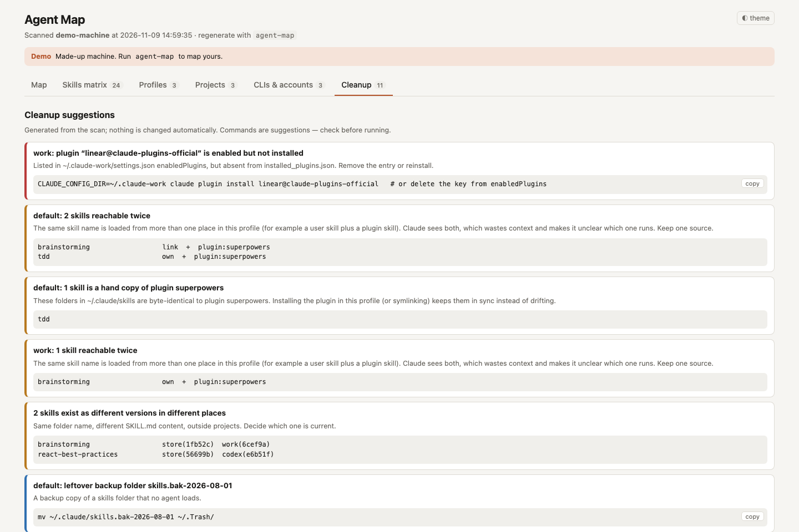

# agent-map

**Where did all my skills come from?**

If you use Claude Code with more than one account, plus Codex, Cursor or Gemini, plus `npx skills`, plugins and a few hand-copied `SKILL.md` folders, you probably can't say which skills each agent actually loads. `agent-map` scans your machine and draws it on one local page.



```bash
uvx --from git+https://github.com/manghat/agent-map agent-map --demo   # try it on a made-up machine
uvx --from git+https://github.com/manghat/agent-map agent-map          # map yours
```

No dependencies beyond Python 3.9+. Nothing is uploaded: it reads config files and writes one HTML file.

## What you get

- **Map:** skill sources (the `~/.agents/skills` store, plugin marketplaces, claude.ai synced skills, hand-made folders) → every Claude profile and agent CLI → the MCP servers each one can reach. Hover to trace a line.
- **Skills matrix:** one row per skill, one column per place it loads from. Filter by "loaded twice in one profile", "different versions" or "copied by hand".
- **Profiles:** each `CLAUDE_CONFIG_DIR` with its account, model, hooks, plugins (enabled, disabled, or enabled-but-missing), MCP servers, agents and commands. Profiles launched through shell aliases (`alias claude-work='CLAUDE_CONFIG_DIR=… claude'`) are found and labelled with their alias.
- **Projects:** every folder an agent has opened, with its project-level skills, `.mcp.json`, plugins, Vercel link and Neon endpoints.
- **CLIs & accounts:** which account Neon, Vercel, GitHub, gcloud, AWS, Supabase, Modal, Turso, Convex and wrangler are logged in as, and which alias pins which one.
- **Cleanup:** concrete suggestions, for example the same skill loaded twice in one profile, a plugin enabled but never installed, byte-identical copies that should be a symlink, or two drifted versions of one skill. Nothing is changed for you.



## Install

```bash
# run without installing
uvx --from git+https://github.com/manghat/agent-map agent-map

# or install the command
pipx install git+https://github.com/manghat/agent-map
# or
uv tool install git+https://github.com/manghat/agent-map

# or from a clone
git clone https://github.com/manghat/agent-map && cd agent-map && python3 -m agent_map
```

## Usage

```
agent-map              scan and open the map (~/.agent-map/index.html)
agent-map --redact     replace emails, orgs, account ids, profile names, hostname and project paths
agent-map --demo       map a made-up machine instead of yours
agent-map --live       also ask neonctl / vercel / gh who is logged in (network calls)
agent-map --no-open    write the file without opening a browser
agent-map --json       print the raw scan
agent-map -o FILE      write somewhere else
```

## Sharing a screenshot

The normal map shows your emails, org names and every project path. **Use `agent-map --redact` before you screenshot or share it.** Redaction swaps emails for `user1@example.com`, profiles for `profile-2`, projects for `~/projects/project-07`, removes skill descriptions and account ids, and keeps skill, plugin and MCP server names. It is best-effort: a skill or MCP server named after a client will still show, so look before you post.

## What it reads

Everything is read-only, and credential files are only checked for existence or a user id, never for token values.

| Where | What for |
| --- | --- |
| `~/.claude`, `~/.claude-*`, any `CLAUDE_CONFIG_DIR` in your shell aliases or environment | profiles: `settings.json`, `.claude.json`, `skills/`, `plugins/`, `agents/`, `commands/` |
| `~/.zshrc`, `~/.bashrc`, `~/.zprofile`, fish `config.fish`, and friends | `alias` lines, to find profiles and pinned CLI accounts |
| `~/.agents/skills`, `~/.agents/.skill-lock.json` | the shared skill store used by `npx skills` |
| `~/.codex`, `~/.gemini`, `~/.cursor`, `~/.config/opencode`, `~/.copilot`, `~/.config/amp` | other agents' skills, MCP servers and projects |
| each project an agent has opened | `.claude/`, `.agents/skills`, `.mcp.json`, `.vercel/`, `CLAUDE.md`, `AGENTS.md`, and the Neon endpoint hostname in `.env*` (nothing else from those files is kept) |
| `~/.config/neonctl*`, `~/.config/gh/hosts.yml`, gcloud, AWS, Supabase, Modal, Turso, Convex | which accounts exist and where their config lives |

`--live` is the only mode that runs other programs (`neonctl me`, `vercel whoami`, `gh auth status`).

## Platform support

macOS and Linux. Windows isn't tested.

## Development

```bash
python3 -m unittest discover -s tests   # tests build a fake home with agent_map/demo.py
python3 -m agent_map --demo             # look at the page while you change agent_map/template.html
```

The scanner (`agent_map/scan.py`) produces one JSON document. The page (`agent_map/template.html`) is a single self-contained file that renders it, with no network requests. New agents usually take one `add(...)` call in `other_agents()`.

## License

MIT
